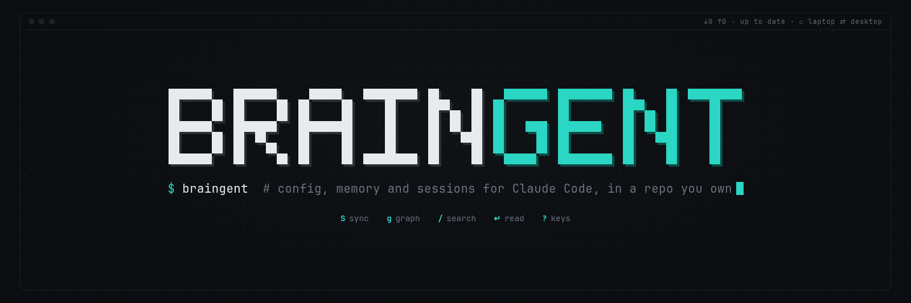
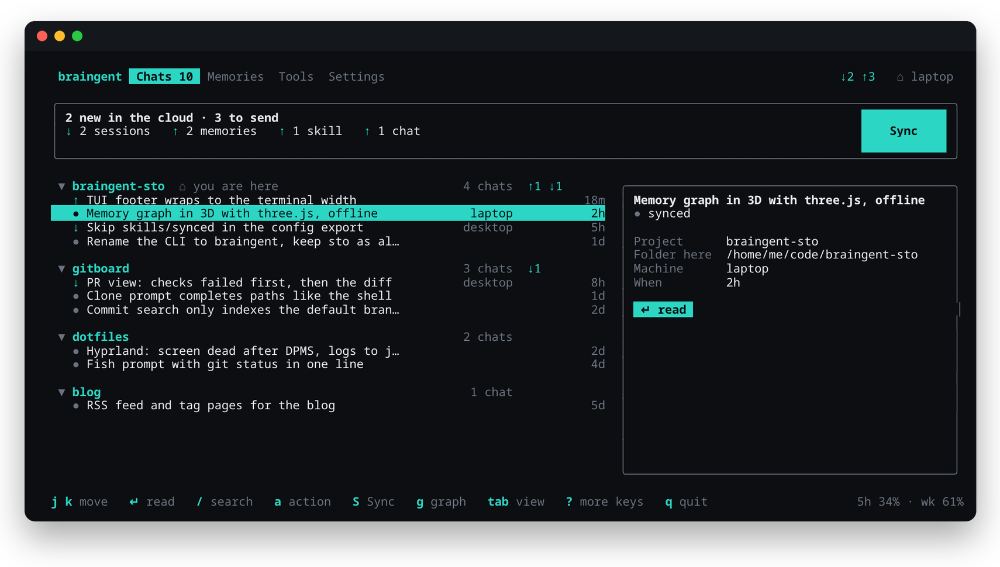
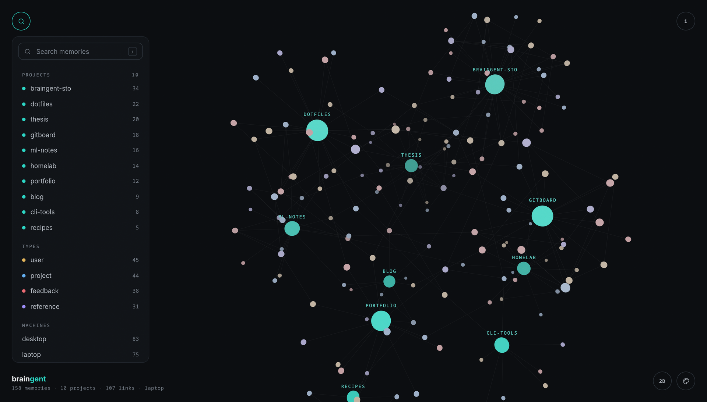

<p align="center">
  
</p>

<p align="center">
  
  
  
  
</p>

<p align="center">
  <a href="#features">Features</a> &nbsp;•&nbsp;
  <a href="#setup">Setup</a> &nbsp;•&nbsp;
  <a href="#commands">Commands</a> &nbsp;•&nbsp;
  <a href="#stack">Stack</a> &nbsp;•&nbsp;
  <a href="#what-it-does-not-do">Limits</a>
</p>

braingent keeps Claude Code the same on every machine you use. Your `~/.claude` config, skills and plugins, the memories the agent writes and the transcripts of every session go into one private git repo, and come back out on the other machine with one key. No daemon, no API key, no third-party service: a Python stdlib engine, `git`, and a terminal UI in Go.

Claude Code still has [no way to sync config and skills across machines](https://github.com/anthropics/claude-code/issues/36693), and its auto memory is [explicitly not shared across machines](https://code.claude.com/docs/en/memory#storage-location). The tools around it each cover one part: memory stores (claude-mem, engram) keep config on one machine, config syncers (claude-sync) carry no sessions, session browsers (claude-code-log) are local only. braingent does the three on one substrate, and everything in it is plain text you can read, `grep` and `git revert`.

<p align="center">
  
</p>

## Features

- **Built on the native memory, not beside it.** Claude Code already writes its memories as markdown under `~/.claude/projects/*/memory/`. braingent mirrors those exact files between machines: no second store, nothing to paste into `CLAUDE.md`, nothing new for the model to learn.
- **One sync for everything.** Sessions, memories, the vault and the `~/.claude` modules you pick (`claude-md`, `settings`, `skills`, `agents`, `hooks`, `plugins`) move together, and missing plugins and marketplaces get installed on arrival. Transcripts are trimmed to prompts, tool names and errors and scrubbed of key-shaped strings before they reach a commit.
- **Sessions that resume anywhere.** A chat from the laptop opens on the desktop with `claude --resume`: it is filed under the path this machine registered for the project. `braingent keep <id>` archives a transcript in full when the tool outputs matter.
- **A TUI with one question on top.** Chats, Memories, Tools and Settings under a card that says in one phrase what Sync would move. It reads and acts only through `braingent data` / `braingent act`, so it holds no rule of its own. Built on first run with Go, or downloaded prebuilt when Go is missing.
- **A memory graph.** Every memory of every machine as a 3D map, linked by its `[[wikilinks]]`: click a project to focus its part, read any memory in full, copy it with `c`. One offline HTML file in the TUI's accent, with a paper theme behind a button.
- **Inside Claude Code too.** The `sto-band` mod puts a band above the prompt with the same state (↓ waiting in the cloud, ↑ waiting here) and a Sync button that shows only when something is pending.

<p align="center">
  
</p>

## Setup

You need Python 3.11+ and `git`; Go is optional. On the first machine, clone the public repo and make it yours:

```bash
git clone https://github.com/SimonOcampo1/braingent-sto.git && cd braingent-sto
sh scripts/install_cli.sh   # Windows: powershell -ExecutionPolicy Bypass -File scripts/install_cli.ps1

git remote rename origin upstream    # the public repo: where updates come from
git remote add origin git@github.com:<you>/<private-repo>.git   # an empty private repo
git push -u origin main
braingent push                       # sessions, memories and config, up
```

On every other machine, clone **your private repo**, run the same installer, then `braingent pull` and `braingent push`. A machine that already had months of memories publishes them on that first push; pulling first never overwrites a memory it has not published yet.

`braingent update` merges `upstream` into your repo. The public repo has never held a file under `knowledge/memory/`, so an update has nothing to overwrite there. Keep your repo **private**: it carries your transcripts.

## Commands

`bgent` is the same command, shorter.

| Command | What it does |
|---|---|
| `braingent` | the TUI |
| `braingent push` / `pull` | export and upload / download and apply |
| `braingent status` | where sync stands |
| `braingent graph --memory` | the memory graph |
| `braingent search <text>` | full text across every session of every machine |
| `braingent resume <id>` / `keep <id>` | bring a session here / archive one in full |
| `braingent update [--apply]` | updates to braingent itself, from `upstream` |

The mod, from Claude Code: `/plugin install sto-band --marketplace SimonOcampo1/braingent-sto`. Then `/braingent sync` syncs and `/braingent auto` toggles syncing on its own.

## Stack

| Layer | Technology | Why |
|---|---|---|
| Engine | Python 3.11, stdlib only | no `pip install`, no server: the CLI imports the engine |
| Sync | `git` | your repo, your history; conflicts are git conflicts |
| TUI | Go, Bubble Tea v2 | one binary per platform, published by a workflow |
| Graph | three.js, vendored and inlined | opens offline in a Chromium window or the browser |

```
scripts/      engine (sessions_server.py), CLI (cli.py), strings (i18n.py), graph template
tui/          the Go TUI
mod/          the Claude Code band
knowledge/    what travels: sessions, memory, config  (only in your private repo)
vault/        curated notes: raw/ → wiki/
```

## What it does not do

- **No semantic recall.** Search is lexical; for vectors inside the agent loop, run claude-mem or engram alongside it.
- **No memory of its own.** Claude Code writes the memories; braingent makes them travel. No background job distils anything.
- **Single user.** It syncs your machines, not a team.

Tests: `cd scripts && for t in test_*.py; do python $t; done` and `cd tui && go test ./...`. What is next lives in [ROADMAP.md](ROADMAP.md).
